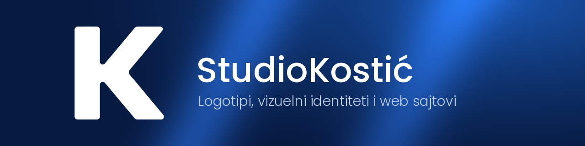
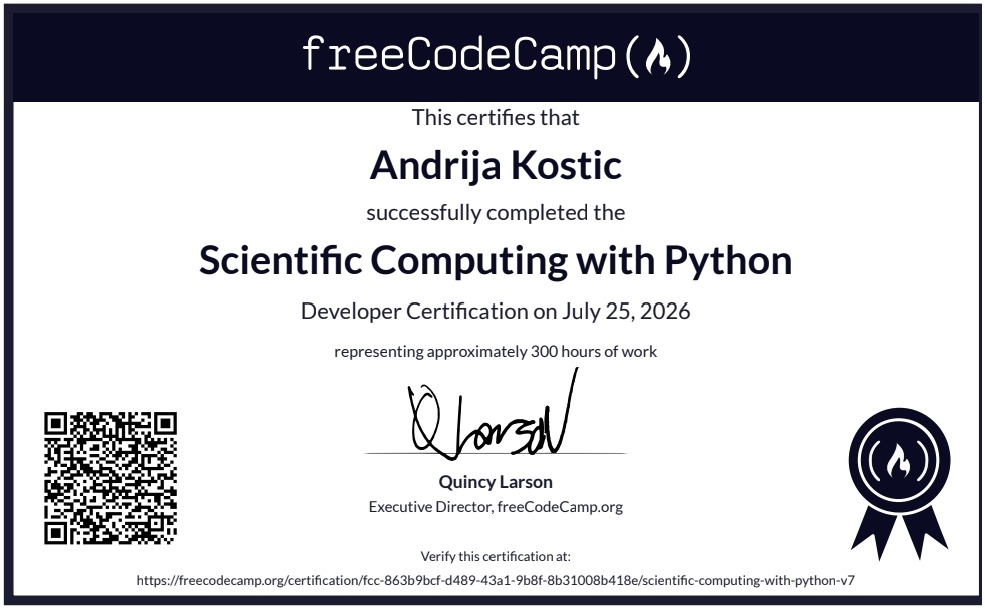

<!-- README za repozitorijum StudioKostic (github.com/Andrija-Kostic/StudioKostic)
     U koren repozitorijuma otpremi: README.md, banner-studiokostic.png i sertifikat-freecodecamp.jpg
     Zameni sve što je označeno sa ZAMENI. -->

  

<h3 align="center">Brend koji izgleda kao da je tu oduvek.</h3>

  Pravimo logotipe, vizuelne identitete i web sajtove, od prve skice do gotovog proizvoda.

  
  
  

---

## Šta radimo

<table>
  <tr>
    <td width="33%" valign="top">
      <h4>Vizuelni identitet</h4>
      Logotip, paleta boja, fontovi i pravila primene, spakovani u brend kit koji možeš da proslediš svakome ko radi za tebe.
    </td>
    <td width="33%" valign="top">
      <h4>Web dizajn i razvoj</h4>
      Sajtovi pisani ručno, bez gotovih šablona. Brzi, prilagođeni telefonu i spremni za pretraživače.
    </td>
    <td width="33%" valign="top">
      <h4>Grafički dizajn</h4>
      Vizit karte, objave za društvene mreže, prezentacije i štampani materijal u duhu tvog brenda.
    </td>
  </tr>
</table>

---

## Kako izgleda saradnja

| 01 Razgovor | 02 Ponuda | 03 Izrada | 04 Isporuka |
| :--- | :--- | :--- | :--- |
| Šta radiš, kome se obraćaš i šta ti treba | Jasan obim posla, rok i cena pre početka | Rad pokazujemo u fazama, a ti kažeš šta treba izmeniti | Svi fajlovi i uputstvo, spremni za upotrebu |

---

## Alati

<!-- ZAMENI: ostavi samo alate koje stvarno koristiš -->

**Dizajn**

  
  
  

**Razvoj**

  
  
  
  
  

**Isporuka**

  
  
  

---

## Sertifikati

  

**Scientific Computing with Python**, freeCodeCamp, Developer Certification (jul 2026, oko 300 sati rada). [Proveri sertifikat](https://www.freecodecamp.org/certification/fcc-863b9bcf-d489-43a1-9b8f-8b31008b418e/scientific-computing-with-python-v7)

**Akademija Oxford, Jagodina (decembar 2025, po 27 školskih časova)**

- Adobe Photoshop, osnovni nivo
- Adobe Illustrator, osnovni nivo
- Korišćenje veštačke inteligencije, AI alati
- Multimedijalni alati

---

## Kontakt

Opiši nam u par rečenica šta ti treba, pa ćemo zajedno dogovoriti sledeći korak.

**Instagram:** [@studiokostic](https://instagram.com/studiokostic) &nbsp;·&nbsp; **Sajt:** [studiokostic.com](https://studiokostic.com)

© 2026 StudioKostić

